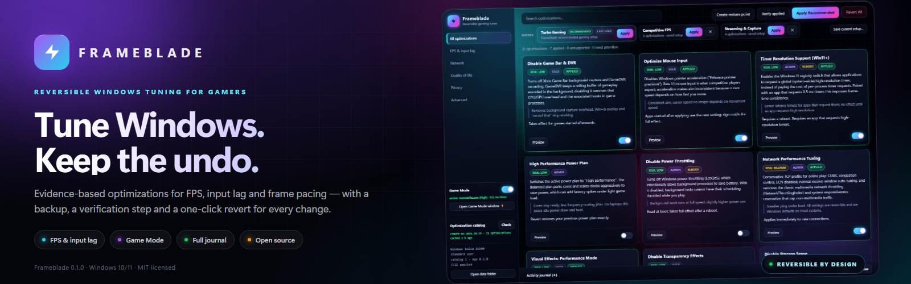
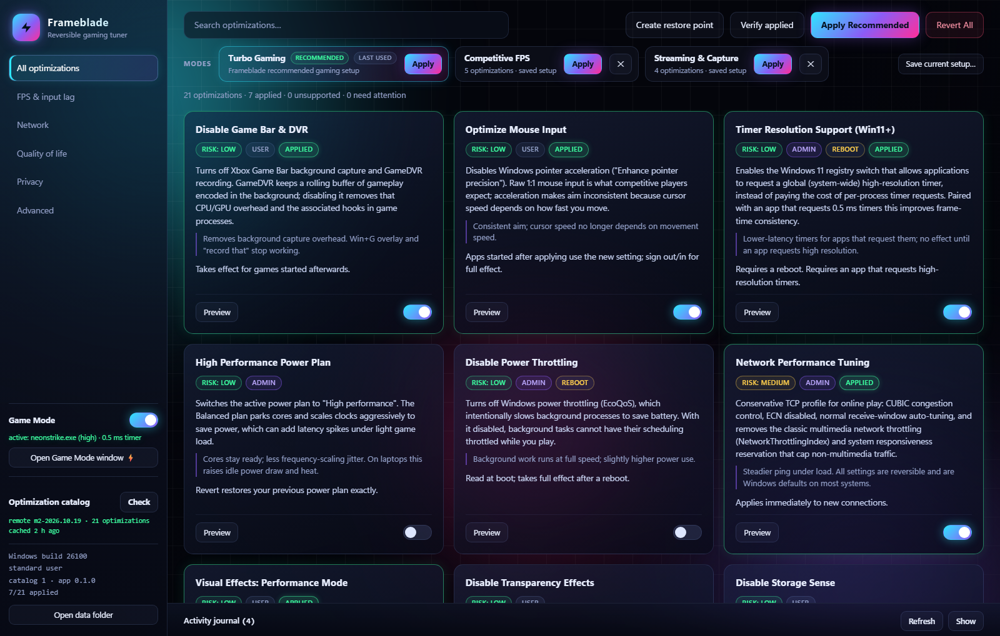
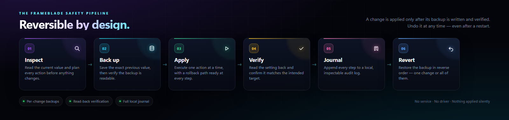
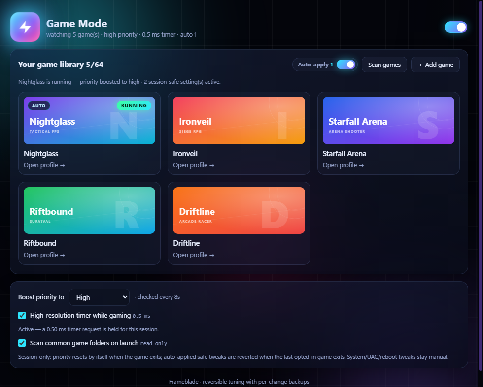
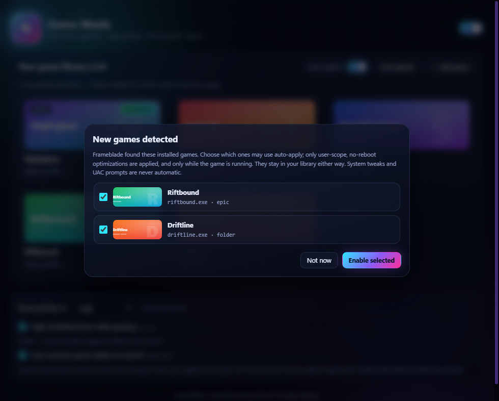

# Frameblade



[](https://github.com/Indiangamer001/frameblade/releases)
[](https://github.com/Indiangamer001/frameblade/actions/workflows/ci.yml)
[](LICENSE)


A reversible Windows optimization app for gamers, built as a working replication of
Hone's architecture (based on the private design blueprint `HONE-Replication-Report.md`;
the research report itself is not distributed in this repository). **Current scope:**
Electron shell + unprivileged core engine + elevated helper + 21 hand-built tweaks with
backup → verify → apply → revert and a full journal, plus M2 modes/profiles, the
restore-point guard, the exit flow, and a Game Mode session watcher that discovers
installed games, boosts their process priority, can hold a 0.5 ms timer request, and can
apply an opt-in session-safe subset of recommended tweaks while an opted-in game runs.

> Renamed from the working title "PC Tune". The app migrates an existing
> `%LOCALAPPDATA%\PCTune\` folder to `%LOCALAPPDATA%\Frameblade\` on first start, so
> backups and applied state survive the rename. The brand lives in
> `src/shared/brand.ts` (plus the static text in `src/renderer/index.html`).

Nothing here is installed as a service or driver. Every change is written to a backup
file first and can be reverted from the UI ("Revert All") — including after a restart.

## A look inside



*Interface preview rendered from the real renderer with sample data — nothing is applied
by the screenshot. The catalog ships 21 optimizations. The remote-catalog cache shown is
simulated because the default resource endpoint is still a placeholder.*

## Quick start

```powershell
npm install        # first time (downloads the Electron runtime)
npm start          # build + launch the app
npm test           # build + run the engine unit tests
npm run selftest   # end-to-end apply/revert round-trip on a scratch registry key
```

CLI (useful for a quick look without the UI; run as admin for system tweaks):

```powershell
node dist/cli.js list                 # catalog + current status
node dist/cli.js plan all             # dry-run preview of every change
node dist/cli.js apply recommended    # apply the recommended set
node dist/cli.js revert all           # revert everything applied
node dist/cli.js journal 40           # last 40 journal lines
```

## Code signing policy

**Signing status:** [SignPath Foundation](https://signpath.org) declined the free certificate because the project is new and does not yet have enough public visibility. The active route is a [Certum Open Source Code Signing](https://certum.store/open-source-code-signing-on-simplysign.html) certificate. Frameblade 0.1.0 and 0.1.1 are published unsigned while signing is pending, so Windows may show an unknown-publisher or SmartScreen warning.

- **Authors / committers:** [Vasim Pathan (@Indiangamer001)](https://github.com/Indiangamer001)
- **Reviewers:** [Vasim Pathan (@Indiangamer001)](https://github.com/Indiangamer001)
- **Approvers:** [Vasim Pathan (@Indiangamer001)](https://github.com/Indiangamer001)
- **Privacy policy:** [PRIVACY.md](PRIVACY.md)
- **Full policy:** [CODE_SIGNING_POLICY.md](CODE_SIGNING_POLICY.md)

The build is reproducible from the public source and the release workflow runs
`npm ci`, `npm test`, and `npm run dist` on GitHub-hosted Windows runners.

## Packaging (installer)

```powershell
npm run dist        # NSIS installer  -> release\Frameblade-<version>-Setup.exe
npm run dist:dir    # unpacked build  -> release\win-unpacked\Frameblade.exe
npm run icon        # regenerate build\icon.png / icon.ico (pure Node, no image deps)
```

- **Per-user install**: the installer writes to `%LOCALAPPDATA%\Programs` and needs no
  admin rights. System tweaks still prompt for UAC per batch, exactly like the dev build.
- **Code signing**: 0.1.0 and 0.1.1 are unsigned, so Windows reports an unknown
  publisher and SmartScreen may warn. The signing pipeline and certificate options are
  documented in [docs/CODE-SIGNING.md](docs/CODE-SIGNING.md); once a certificate is
  installed, `npm run dist:signed -- -Thumbprint <thumbprint>` signs and verifies both
  the app and the installer. Never commit a private key, PIN or PFX password.
- **No system Node.js required**: the elevated helper runs through the app's own
  Electron binary in Node mode (see Execution model below).
- Packaged data still lives in `%LOCALAPPDATA%\Frameblade\` — dev and installed builds
  share the same state, backups and journal.

## What's in the catalog (21 tweaks)

| id | scope | what it does |
|---|---|---|
| `disable-game-bar-dvr` | user | Game Bar capture + GameDVR background recording off |
| `optimize-mouse-input` | user | pointer acceleration off (raw 1:1 input) |
| `timer-resolution` | admin (Win11+) | `GlobalTimerResolutionRequests=1` (global hi-res timer support) |
| `power-plan-high-performance` | admin | active power plan → High performance (previous plan backed up) |
| `disable-power-throttling` | admin | `PowerThrottlingOff=1` (EcoQoS off) |
| `network-performance-tuning` | admin | CUBIC + ECN off + normal auto-tuning, NetworkThrottlingIndex/SystemResponsiveness |
| `visual-effects-performance` | user | VisualFXSetting=2, taskbar animations off, menu delay 0 |
| `disable-transparency` | user | acrylic/blur composition off |
| `storage-sense-off` | user | no automatic cleanup mid-session |
| `onedrive-autostart-off` | user | OneDrive removed from Run key (entry backed up, app untouched) |
| `reduce-telemetry-core` | admin | AllowTelemetry=0, DiagTrack disabled+stopped, appraiser task off |
| `disable-sysmain` | admin | SysMain (Superfetch) service stopped + disabled (background disk activity off) |
| `priority-separation-gaming` | admin | `Win32PrioritySeparation=26` — games preset (fixed short CPU quanta, foreground boost) |
| `disable-lso-offloads` | admin | Large Send Offload off on physical NICs (per-property backup) |
| `disable-vbs-hyperv` | admin | `bcdedit hypervisorlaunchtype off` + VBS/HVCI/Credential Guard off (High risk, reboot) |
| `disable-mitigations` | admin | `FeatureSettingsOverride(Mask)=3` — Spectre/Meltdown mitigations off (High risk, reboot) |
| `disable-defender-realtime` | admin | Defender real-time policy off (High risk; Tamper Protection may override) |
| `disable-mpo` | admin | `OverlayTestMode=5` — Multi-Plane Overlay (MPO) composition off |
| `disable-dynamic-interrupt-steering` | admin | hidden power setting `SUB_INTSTEER/MODE` → Lock Interrupt Routing (Win11 22H2+) |
| `disable-ntfs-last-access` | admin | `NtfsDisableLastAccessUpdate=1` — no access-time writes on file reads |
| `disable-disk-quotas` | admin | NTFS disk-quota policy off (1.4-era extra) |

The Advanced rows mirror Hone's **Advanced Settings** list and its security-trade-off
optimizations (see report §6.2 items #8, #42–45, #47). High-risk tweaks show a red warning
and require an explicit "I understand" checkbox before they can be applied. The app never
applies anything silently.

Notes on the advanced mechanisms:

- **VBS/Hyper-V** uses `bcdedit` with the ID omitted (`{current}` is implicit) — this is more
  portable than passing `{current}`, which some bcdedit builds reject. Reading bcdedit needs
  admin, so its plan row shows "(requires administrator to read)" until applied through the UAC flow.
- **LSO** targets every physical adapter property whose `RegistryKeyword` matches `Lso`
  (e.g. `*LsoV2IPv4`, `*LsoV2IPv6`) and backs up each property value for exact revert.
- **TCP congestion provider** uses `Set-NetTCPSetting -SettingName Internet -CongestionProvider`
  on modern Windows (Windows 11 rejects `netsh int tcp set global congestionprovider`);
  ECN and auto-tuning still go through `netsh int tcp set global`. Revert restores the
  captured provider through the same cmdlet, including LEDBAT/BBR2 values.
- **Interrupt Steering Mode** is a hidden power setting (aliases `SUB_INTSTEER` / `MODE`,
  GUIDs `48672f38-…` / `2bfc24f9-…`) with indexes 0–6 (0=Default, 4=Lock Interrupt Routing).
  Hidden settings are read with `powercfg /qh`.
- **Mitigations** writes the documented `FeatureSettingsOverride`/`FeatureSettingsOverrideMask`
  pair in `Memory Management` (values 3/3 disable the mitigations).
- **MPO** writes the documented DWM `OverlayTestMode=5` compatibility switch. It takes
  effect after a DWM restart (sign out/in) and helps only on driver/display combinations
  where MPO causes flicker or presentation stutter; revert if frame times worsen.
- **NTFS last access** uses the documented `NtfsDisableLastAccessUpdate` value (`1` =
  user-managed, updates disabled). Unlike the older `fsutil` presets it is a plain DWORD,
  so the normal backup/verify/revert path applies; file timestamps themselves are untouched.

## Architecture

```
src/
  shared/     types.ts (tweak DSL, undo records) · errors.ts (RES/UTIL/OPT taxonomy)
  engine/     win.ts        thin wrappers over reg.exe / PowerShell / netsh / powercfg
              actions.ts    inspect + execute + undo for each action type
              backup.ts     per-tweak backup files (+ verification, UTIL085)
              journal.ts    append-only NDJSON journal
              jobs.ts       elevated-job schema validation + startup reconciliation
              state.ts      applied/reverted/failed state (atomic writes)
              engine.ts     plan → backup → verify → apply → verify → journal, with rollback
              profiles.ts   modes/profiles store (profiles.json)
              restore.ts    System Restore status probe (restore-point guard)
              watcher.ts    Game Mode: tasklist polling, library config, priority boost script
              gamedetect.ts Game Mode: read-only Steam/Epic/GOG/common-folder discovery
              timer.ts      Game Mode: gated 0.5 ms NtSetTimerResolution helper process
              steam.ts      Steam library discovery (appmanifest parsing, cover art)
              resources.ts  signed remote catalog: download, verify, validate, cache
  catalog/    tweaks.ts     21 tweak definitions · catalog.ts (versioning, remote merge, helpers)
  main/       main.ts       Electron main; splits user (in-process) vs system (elevated job);
                            Game Mode poll loop; Game Mode window; catalog sync; exit interception
              elevation.ts  UAC job launcher + wait-for-result + restore point helper
              preload.ts    contextBridge API (the renderer's only surface)
  helper/     helper.ts     runs elevated, validates one job, writes a canonical result file
  renderer/   index.html · styles.css · app.js (vanilla, no bundler)
              game.html · game.js  (Game Mode: flash sign, auto-detected library, auto-apply consent)
  cli.ts      command-line harness over the same engine
  tests/      unit tests: parsers, catalog invariants, jobs, backups, timeouts, watcher, gamedetect, timer, Steam, resources
```

### Execution model

- **User-scope tweaks** (HKCU etc.) need no elevation and run in-process.
- **System-scope tweaks** are batched into one job and run through a single UAC prompt.
  An encoded PowerShell command launches the app's own executable with an internal
  `--frameblade-helper` flag. No user-writable `.cmd`/`.ps1` launcher
  is created, so a local process cannot race the prompt by editing a script.
  The helper validates the canonical data directory, job id, result path and
  system-tweak scope before constructing the same `Engine` with `elevated: true`; it
  writes a canonical `<job>.res.json`. **No system Node.js install is required**
  (`PCTUNE_NODE` remains available for development overrides). Stale jobs are
  reconciled at startup: completed results are journaled, interrupted jobs are
  reported, and old artifacts are removed.
- **Invariant:** a tweak is all-user or all-system, so a helper job never touches the
  interactive user's registry hive.

### Safety pipeline (per tweak)

1. `inspect` every action (current state + undo record),
2. write `backups/<tweakId>.json` and **verify** it (structural + live spot-check → `UTIL085`),
3. execute actions one at a time, each followed by a read-back verification,
4. on any failure: automatic rollback of already-applied actions (newest first) and
   `state.json` records the error,
5. append every step to `journals/journal.ndjson`; revert replays the backup in reverse
   and verifies each restore.



*Inspect → back up → apply → verify → journal → revert. The backup is written and verified
before the first action runs.*

Data lives under `%LOCALAPPDATA%\Frameblade\` (`state.json`, `backups/`, `journals/`,
`jobs/`, `profiles.json`, `watcher.json`, `thumbs/` with `thumbs/covers/`, `resources/`
with the catalog cache/config).
The sidebar button opens it. The **Activity journal** bar at the bottom of the window is
hidden by default — click **Show** to view it (the choice is remembered). The log is always
written to disk regardless of whether the panel is visible.

### Error codes

`OPT002` action failed verification · `OPT007` action timed out (watchdog) ·
`UTIL004` elevation required/denied · `UTIL007` unsupported on this OS ·
`UTIL085` backup verification failed · `RES001` resource access/endpoint policy ·
`RES002` catalog download failed · `RES003` catalog needs a newer client/format/key ·
`RES004` catalog signature/schema invalid · `RES005` catalog cache write failed ·
`RES009` cache/backup missing or corrupt · `ELEVATION_CANCELLED` UAC prompt dismissed.
Codes mirror the report's taxonomy so logs are support-friendly.

## Modes, profiles and the restore-point guard (M2)

**Modes** are one-click presets of catalog tweaks:

- **Turbo Gaming** — the recommended gaming setup (every `recommended: true` catalog
  item), shown with a "recommended" badge in the Modes bar.
- **Saved profiles** — "Save current setup…" snapshots the currently applied
  optimization set under a name in `profiles.json`. Applying a profile re-applies
  exactly that set; saving with an existing name updates it.
- The last mode you applied is remembered. If nothing is applied on the next launch,
  a "Welcome back" banner offers a one-click re-apply.

**Restore-point guard**: before any mode, saved profile or recommended set is applied,
the app checks whether System Restore is enabled and when the last restore point was
created (unelevated reads may be denied — that is reported as "couldn't verify" advice,
not an error). When there is no recent point, the apply dialog offers
"Create a System Restore point first" (checked by default) and creates one — with UAC —
before applying; if creation fails you can still apply anyway. Frameblade's own
per-tweak backups remain the primary revert mechanism — the restore point is the
belt-and-braces layer.

**Exit flow**: closing the app while optimizations are applied opens an exit dialog:
keep changes and exit, restore old settings and exit, or restore old settings and
reboot (25-second countdown; `shutdown /a` cancels). If a restore fails, the app stays
open and lists exactly what went wrong.

**Game Mode** has its own window (⚡ "Open Game Mode window" in the sidebar): a session
watcher that raises your games' process priority while they run. It can also detect
installed games and, only after per-game consent, apply a small session-safe subset of
the recommended tweaks while an opted-in game runs.

<p align="center">
  
</p>

*Game Mode preview with a fictional sample library and original cover art. The real library
reads Steam cover art from your local cache or the Steam CDN; **＋ Add game** opens the
native `.exe` picker and **Scan games** refreshes the auto-detected library.*

<p align="center">
  
</p>

*New games are added to the library automatically, but auto-apply stays off until you answer
the one-time prompt for them. **Not now** keeps the game and remembers the choice.*

- The window opens with the frameblade flash sign, which pulses while a watched game is
  running, plus the on/off toggle and priority selector. Windows carry no
  File/Edit/View menu bar — the UI is fully custom.
- **Game library**: a launcher-style tile grid. Tiles show real cover art where available:
  for Steam games the banner comes from Steam's local library cache
  (`appcache\librarycache\<appid>\header.jpg`), falling back to Steam's public CDN
  (`cdn.cloudflare.steamstatic.com`), and a user-picked image always wins (cached under
  `thumbs\covers\`). Display titles come from Steam app manifests or launcher
  metadata for detected games. Games
  without art get a gradient tile with the exe icon (extracted via System.Drawing) and a
  name monogram. **＋ Add game** opens the native `.exe` picker — full path kept, icon and
  Steam appid detected automatically; **Open profile →** on a tile shows the file
  location, cover picker and remove action.
- **Installed-game detection** scans Steam libraries (`libraryfolders.vdf` +
  `appmanifest_*.acf`), Epic manifests, GOG `goggame-*.info` metadata, Xbox/`Games` folders,
  and common launcher roots for Epic, GOG, Ubisoft, Riot, EA/Origin, Rockstar, Amazon,
  Battle.net/Blizzard and Xbox. It adds
  new finds to the library with a one-time prompt per game: choose which games may use
  auto-apply, or choose **Not now** and enable them later from their profile. Detection is
  read-only; it never changes settings. Auto-scan on launch is on by default and can be
  turned off in the Game Mode window; **Scan games** still works manually. Removed games
  are remembered so a rescan does not re-add them.
- Watched games are stored in `watcher.json` (v3 entries:
  `{ exe, path, title?, appid?, source?, autoApply?, prompted? }`; v1/v2 files migrate
  automatically). A background poll (`tasklist`, default every 8 s) checks whether one is
  running.
- On detection the app sets the game process's priority class (Normal / Above normal /
  High, default High). On exit nothing needs reverting: process priorities are
  session-only and disappear with the process — that is the whole reason this feature
  is safe enough to run automatically. Start/exit events land in the Activity journal
  under `game-mode`.
- **Auto-apply (opt-in, off until you choose a game)**: while an opted-in game runs,
  Game Mode can apply the *session-safe* recommended subset — currently
  **Disable Game Bar / DVR** and **Visual Effects: Performance**. These are user-scope,
  no-reboot tweaks, so no UAC prompt, service or reboot appears mid-game. Values are
  applied through the normal engine (backup + journal) and reverted when the last
  opted-in game exits; values you applied yourself are detected first and never added to
  the auto-revert set. Normal app exit drains the same set, and a small marker file
  recovers it after a crash. System-scope, UAC and reboot-required recommendations stay
  manual.
  The master switch and per-game toggle are in the Game Mode window. Some settings take
  full effect on the next game launch; the catalog's effective note is shown in the main
  window.
- **High-resolution timer** (optional, off by default): while a watched game runs, a tiny
  PowerShell helper calls `NtSetTimerResolution(5000, TRUE)` — a 0.5 ms request — and holds
  it for the session. Killing the helper releases the request; no service, driver or
  registry value is created by Game Mode.
  - It is **gated on the live registry value** written by the *Timer Resolution Support
    (Win11+)* catalog tweak (`GlobalTimerResolutionRequests=1`). Without that tweak (or
    before its reboot), Windows scopes the request to the helper process only, so the
    helper refuses to start and the journal records why. Enable the optimization, reboot,
    then flip the timer toggle.
  - The helper needs no elevation (no UAC can appear mid-game) and polls the app's PID
    every 5 s, so an app crash cannot leave a request behind. The current resolution is
    shown in the Game Mode window and the main sidebar status line.
- The sidebar keeps a quick on/off toggle and the live status line. Validation rejects
  path separators and shell metacharacters (spaces are allowed — real exe names use
  them), and the PowerShell boost is built from inert characters only (wildcards are
  stripped so a name can never fan out to other processes). Applying optimization sets
  stays in the main window (Apply Recommended / modes) with its restore-point guard.

## Remote resources pipeline (M2)

The catalog ships bundled, but the engine is built for server-delivered packs (report
§5.3 / §12.1): a versioned JSON snapshot is downloaded, verified, cached and loaded at
runtime. Failures never break the app — the bundled catalog stays active and the error
surfaces with a Hone-style `RES` code.

**Envelope** (`catalog-v1.json`):

```jsonc
{
  "format": 1,
  "keyId": "dev-1",
  "signature": "<base64url Ed25519>",
  "payload": "<base64url of the UTF-8 JSON payload>"
}
```

The signature covers `frameblade/catalog;format=<f>;key=<id>\n` + the decoded payload
bytes (Ed25519 via Node `crypto`). The payload is
`{ catalogVersion, publishedAt, minClient?, notes?, tweaks: [...] }` — a full snapshot
using the same tweak DSL as `src/catalog/tweaks.ts`.

**Client rules**

- **Download**: HTTPS only (plain HTTP is allowed *only* for loopback dev servers);
  10 s timeout, 2 MB envelope cap, max 3 redirects that are re-checked against the
  policy, credentials in URLs rejected (`RES001`/`RES002`).
- **Verify before parsing** (`RES004`): key id must be trusted (`RES003` when unknown),
  then signature verification, then JSON parsing.
- **Schema validation**: every tweak/action is rebuilt from an allowlist. Unknown
  action types or fields, bad ids, mixed user/system scopes, HKCU with system scope (or
  HKLM with user scope), oversized payloads and catalogs are rejected (`RES004`). A
  catalog that needs a newer client or envelope format is `RES003`.
- **Cache**: `resources\catalog-cache.json` (atomic tmp+rename, `RES005`), re-verified
  at every startup before the window opens. No usable cache → bundled catalog.
- **Merge**: a remote snapshot overrides bundled tweaks by id and may add new ones.
  Bundled tweaks the snapshot does not mention stay available, so previously applied
  settings can always be reverted.
- **Kill-switch**: a snapshot may mark a tweak `retired` (+ `retiredReason`). Retired
  tweaks are hidden from lists and cannot be applied, but remain revertible. Applied
  retired tweaks are reverted when the user explicitly runs a catalog check — never
  silently at startup; the sidebar warns until then.
- **Status**: the sidebar's *Optimization catalog* card shows source (bundled/remote),
  version, cache age, retired-applied warnings and the last error. **Check** downloads
  and activates a newer snapshot (or reports "up to date") and journals the outcome.

**Trying it locally** (development signing key — never a production trust root):

```powershell
npm run build
npm run catalog:serve -- --port 4180 --configure   # signs with dev-1, writes resources\config.json
# open the app → Optimization catalog → Check
npm run catalog:serve -- --unconfigure             # app returns to the default endpoint
```

`--retire timer-resolution` exercises the kill-switch (comma-separate several ids). The
server self-verifies the envelope before listening. `FRAMEBLADE_CATALOG_URL` overrides
the endpoint per process. `TRUSTED_KEYS` in `src/engine/resources.ts` is the trust root:
a production deployment must replace `dev-1` with real release keys.

**Default endpoint**: `https://resources.frameblade.gg/catalog-v1.json` is a placeholder
until the resource service exists; until then *Check* fails closed with `RES002` and the
bundled catalog remains in use.

## M2 status

Shipped in the M2 wave: modes (Turbo Gaming), saved profiles + last-choice memory,
restore-point guard before set applies, the exit dialog with restore/reboot, Game Mode
session watcher (installed-game detection + process-priority boost + opt-in session-safe auto-apply + gated 0.5 ms timer helper), the bundled helper
runtime (the app executable with a helper flag — no system Node.js needed), the NSIS installer, the signed
remote-catalog pipeline (download → verify → cache → merge, remote kill-switch,
`RES001…RES009`), the 21-tweak catalog (MPO + NTFS last-access additions), and the
on-demand **Verify applied** scan that re-reads every applied setting and reports values
changed by another tool.

Safety hardening shipped in 0.1.1: encoded UAC launches with no writable launcher
scripts, canonical job-path/scope validation, startup reconciliation with running
markers, and SHA-256 backup checksums.

Remaining:

1. Resource service deployment: host `catalog-vN.json` behind the default endpoint and
   replace the development trust key with release keys.
2. Optional "auto-apply a tweak set while a game runs" (needs its own safety design — a
   UAC prompt must never appear mid-game).
3. Code signing for the installer (NSIS packaging itself shipped — see Packaging above).

## Repository, CI and releases

The repository is source-only: `node_modules/`, `dist/`, `build/` and `release/` are
generated and git-ignored. `package-lock.json` is committed so `npm ci` is reproducible.

- **CI** (`.github/workflows/ci.yml`): Windows runner, `npm ci` + `npm test` on pushes
  and pull requests.
- **Tagged releases** (`.github/workflows/release.yml`): pushing a tag such as `v0.1.0`
  runs the tests, builds the NSIS installer, and attaches it plus `SHA256SUMS.txt` to a
  GitHub Release. The installer is intentionally **not** committed: it is roughly
  107 MB, which exceeds GitHub's 100 MB per-file repository limit. Use **Releases** for
  downloads.
- **Source bundle**: `npm run source:zip` writes
  `release/Frameblade-<version>-source.zip` with every tracked source file (no
  `node_modules`, build output or binaries). It is the fastest way to hand the project
  to a fresh machine or upload it through the GitHub web UI; see
  [`docs/GITHUB-UPLOAD.md`](docs/GITHUB-UPLOAD.md).
- **Signing**: builds are unsigned until a code-signing certificate is configured
  (`CSC_LINK` / `CSC_KEY_PASSWORD`, or `win.certificateFile` in `package.json`). SmartScreen
  warns about unrecognized publishers until then.
- **Repository artwork**: the README banner, screenshots and safety diagram live in
  [`docs/assets/`](docs/assets/). `social-preview.png` is sized for GitHub's repository
  social preview (Settings → General → Social preview).

## Ground rules for development

- **Never apply system tweaks from an unelevated dev shell** — the CLI refuses and the
  engine throws `UTIL004`. Use the app (UAC) or an admin terminal.
- `npm test` and `plan` commands are read-only.
- Dry-run is always available: the UI "Preview" button and `cli plan` show current →
  target per action before anything changes.
- If a backup file is missing, revert refuses to guess (`RES009`) — delete
  `state.json` entries or restore manually.
- **Game Mode stays session-only.** Process priorities vanish with the process. The only
  automatic setting changes are the opt-in, user-scope, no-reboot subset above; they go
  through the same backup/journal/revert pipeline and are never applied without per-game
  consent. Do not add system-scope or reboot-required tweaks to auto-apply.
  The timer helper follows the same rule: it refuses to run unless the live
  `GlobalTimerResolutionRequests` gate is enabled, and its request dies with the helper.

## License

MIT — see [LICENSE](LICENSE). Frameblade is an independent project, not affiliated with
or endorsed by Hone; third-party names and trademarks belong to their owners.

